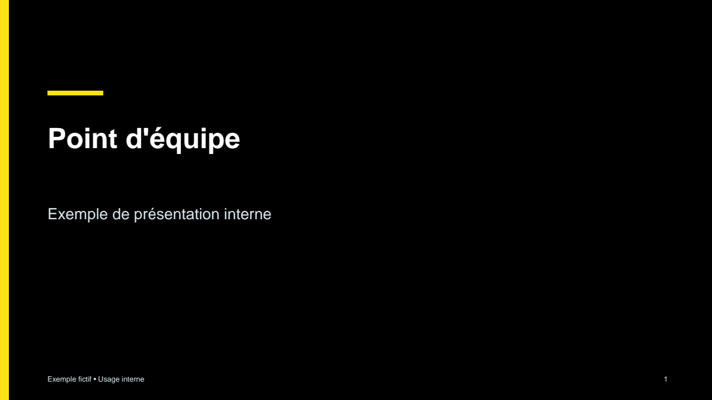
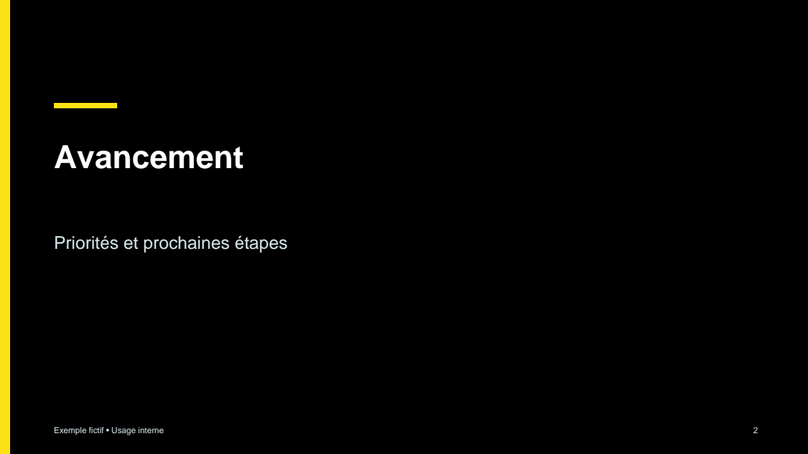
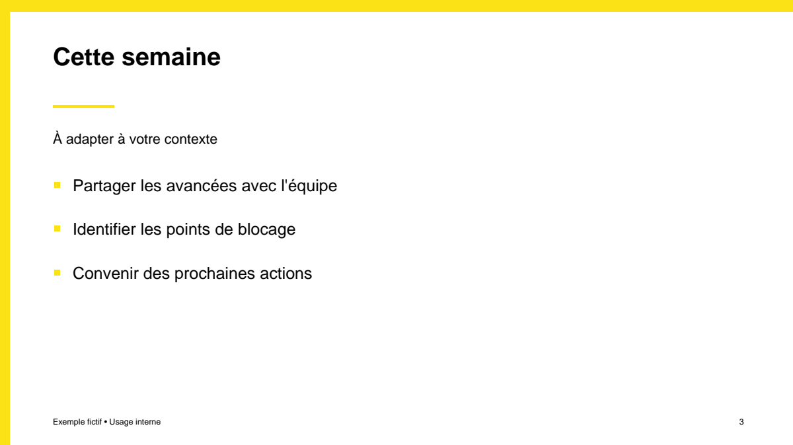
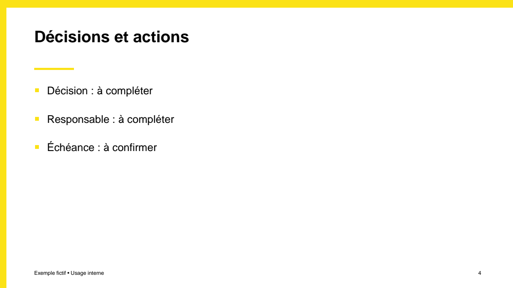
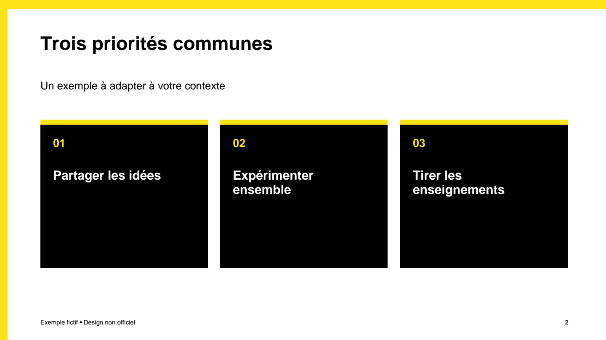

# CESI-inspired presentation generator

Offline generator for editable 16:9 PowerPoint and independently rendered PDF slides from a UTF-8 JSON deck. Its black `#000000`, yellow `#FBE216` and white `#FFFFFF` palette and high-contrast headings are inspired by observations of [the CESI homepage](https://www.cesi.fr/) and its [website stylesheet](https://www.cesi.fr/wp-content/themes/cesi-2022/css/base.min.css?ver=1.4.25). This is **not an official CESI brand guide**; no official logo or endorsement is included. The generator uses Arial and Helvetica, not CESI's web fonts. Obtain authorized materials for official-branded deliverables.

## Aperçus du design

Ces exemples sont des rendus réels du PDF généré à partir de [`examples/internal-update.json`](examples/internal-update.json). Le contenu est fictif et le style est inspiré du site CESI, sans constituer une charte officielle. Le rendu PowerPoint peut légèrement différer.

### Couverture



### Intercalaire de section



### Contenu et points clés



### Décisions et actions



Les deux mises en page suivantes proviennent du PDF réellement généré depuis [`examples/designs.json`](examples/designs.json). Le texte est fictif ; ces designs sont inspirés et non officiels.

### Citation ou message clé (`quote`)


### Trois cartes (`cards`)



Pour générer ces deux diapositives en formats éditable et PDF :

```sh
python scripts/generate.py examples/designs.json --pptx output/designs.pptx --pdf output/designs.pdf
```

Pour reproduire les aperçus PNG à partir du PDF indépendant (nécessite `pypdfium2` et Pillow, non inclus dans les dépendances de base) :

```sh
python -c "import pypdfium2 as p; d=p.PdfDocument('output/designs.pdf'); [(d[i].render(scale=1.5).to_pil().save('docs/design/'+name)) for i,name in enumerate(['quote.png','cards.png'])]"
```

## Setup

Python 3.10+:

```sh
python -m venv .venv
. .venv/bin/activate
python -m pip install -r requirements.txt
python scripts/generate.py examples/internal-update.json --pptx output/deck.pptx --pdf output/deck.pdf
python -m unittest discover -s tests -v
```

On Windows use `.venv\Scripts\activate`. Outputs can be requested separately with `--pptx` or `--pdf`. The script creates parent directories and overwrites existing output files. Input and output paths must differ. It emits JSON on success and exits nonzero on error.

## Input

`slides` is a non-empty array. Each slide has `type` (`title`, `section`, `content`, `quote`, or `cards`; default `content`), required single-line `title` (max 80 characters), optional single-line `subtitle` (max 110). Content slides may include up to five nonempty, single-line `bullets` (max 120 characters each); `cards` requires one to three bullets, displayed as numbered cards. Bullets are not allowed on other types. For `quote`, `title` is the message and `subtitle` its optional attribution. Optional deck-level `footer` has at most 70 characters. Use concise text; character limits alone do not guarantee a fit. The PDF generator rejects text it detects exceeding boxes; PowerPoint can wrap differently and must be visually inspected. Unknown properties are ignored. Images, speaker notes, charts and official templates are not supported.

PDF is **not a conversion of the PPTX**. ReportLab draws its own slide pages using Helvetica, while PPTX uses Arial; rendering and line breaks may differ. Standard PDF fonts are not guaranteed to cover arbitrary Unicode; check glyphs or use an approved font workflow. PPTX-to-PDF fidelity requires a real converter such as LibreOffice, installed separately; for example, convert to a different directory using `soffice --headless --convert-to pdf --outdir converted output/deck.pptx`. Inspect the result. This generator does not invoke LibreOffice.

Tests use unittest and check CLI errors, deck counts and extracted text. Visual verification is separate. Any sample content is fictitious and must not be treated as CESI facts.
